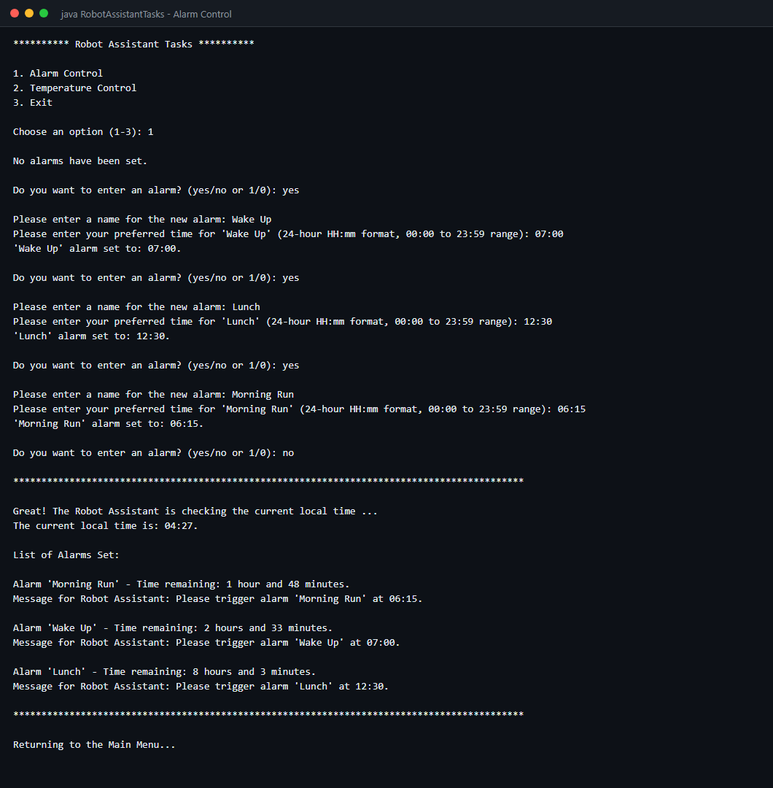
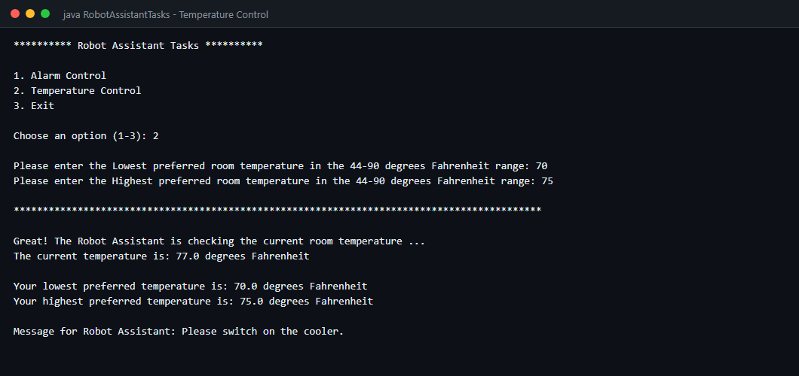
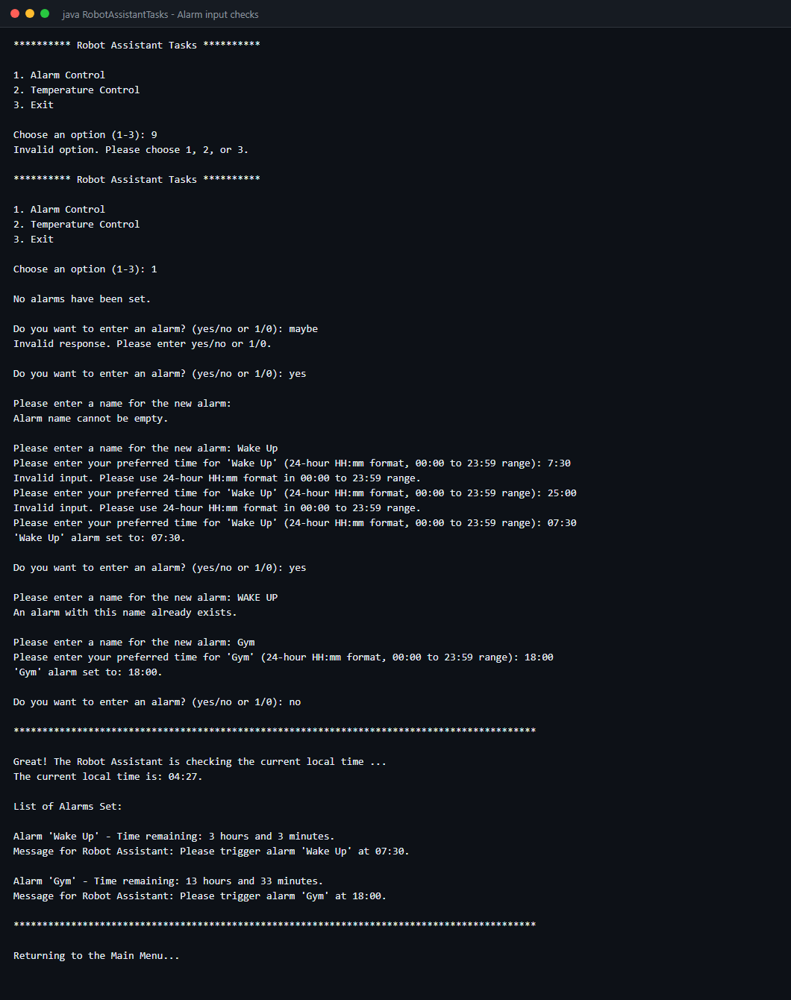
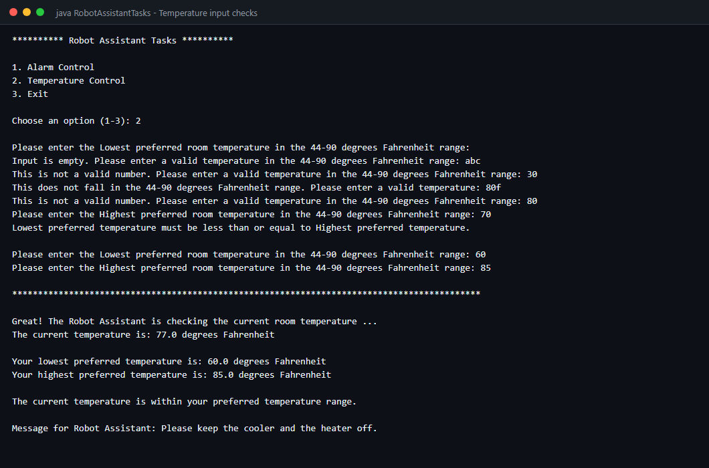

# Robot-Assistant-Project

A command-line Robot Assistant written in Java. It was originally built as a project in **2024**.

The assistant has a simple menu with two tasks:

1. **Alarm Control**: set named alarms in 24-hour `HH:mm` time. The assistant lists them in time order and shows how long is left until each one goes off.
2. **Temperature Control**: enter your lowest and highest preferred room temperatures (44–90 °F). The assistant compares them with the room temperature and decides whether to turn on the heater, turn on the cooler, or keep both off.

## Files

| File | What it does |
| --- | --- |
| `RobotAssistantTasks.java` | Main menu and program entry point |
| `AlarmControl.java` | Adds, checks, sorts and displays alarms |
| `TemperatureControl.java` | Reads temperature preferences and decides heater/cooler action |

## How to run

You need Java 8 or newer. It works the same way on Windows, macOS and Linux.

```bash
javac *.java
java RobotAssistantTasks
```

## Screenshots

### Alarm Control
Three alarms are entered out of order. The assistant sorts them by time and shows how long is left until each one.



### Temperature Control
The preferred range is 70–75 °F and the room is 77 °F, so the assistant turns on the cooler.



### Alarm input checks
Invalid menu choices, invalid yes/no answers, empty names, badly formatted times and duplicate names (in any capitalization) are all rejected.



### Temperature input checks
Empty input, text, out-of-range values, Java number formats such as `80f`, and a lowest temperature above the highest are all rejected.



## Notes

- The room temperature sensor is simulated with a fixed reading of 77 °F.
- Alarms are kept only while the program is running.
- Every input is checked: invalid menu choices, empty names, duplicate alarm names, badly formatted times and out-of-range or non-numeric temperatures are all rejected with a message, and the question is asked again.
